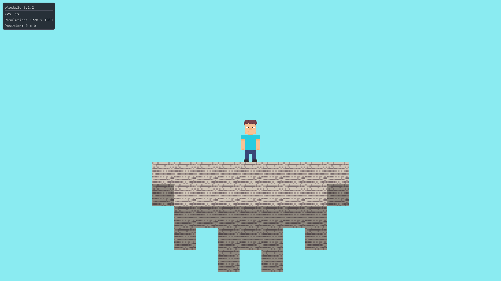
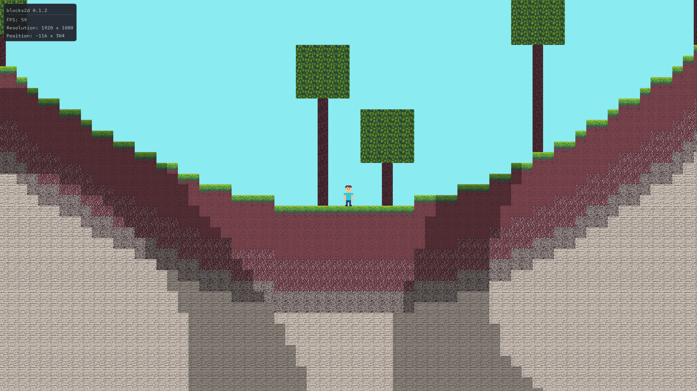
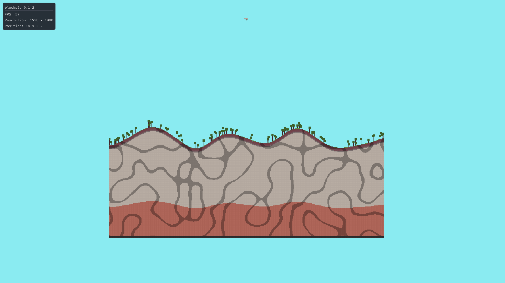

---

> 2D sandbox game. It runs on its own custom engine written in C++





# Latest releases
[`download`](https://github.com/kukemanovdaniil/blocks2d/releases/latest)


# Controls

### Movement
| Key / Action | Description |
| :--- | :--- |
| W, A, S, D | Player Movement |
| Left Shift | Sprint |

### Camera
| Key / Action | Description |
| :--- | :--- |
| Mouse Wheel | Change Zoom |

### Gameplay Action
| Key / Action | Description |
| :--- | :--- |
| R | Change Build Mode |
| Left Click | Place Block |
| Right Click | Break Block |

### Hotkeys
| Key / Action | Description |
| :--- | :--- |
| F8 | Close Game |
| F11 | Toggle Fullscreen |


# Installation

### Binaries

* **[Download Latest Release](https://github.com/kukemanovdaniil/blocks2d/releases/latest)**

---

### Source

```sh
git clone https://github.com/kukemanovdaniil/blocks2d
cd blocks2d
```


# Build

### Linux (native)
```sh
cmake -B build_linux -DCMAKE_BUILD_TYPE=Release
cmake --build build_linux -j$(nproc)
```

---

### Windows (native)
```sh
cmake -B build_linux -DCMAKE_BUILD_TYPE=Release
cmake --build build_linux -j$(nproc)
```

---

### Cross-compile Windows (Linux)
To cross-compile for Windows from Linux, you need to install **MinGW** first

#### 1. Install MinGW

* **Debian**
  ```sh
  sudo apt install -y mingw-w64
  ```
* **Arch**
  ```sh
  sudo pacman -Syu --noconfirm x86_64-w64-mingw32-gcc
  ```
* **Fedora**
  ```sh
  sudo dnf install -y mingw64-gcc mingw64-gcc-c++
  ```

#### 2. Compile
```sh
cmake -B build_windows -DCMAKE_TOOLCHAIN_FILE=win64-toolchain.cmake -DCMAKE_BUILD_TYPE=Release
cmake --build build_windows -j$(nproc)
```

